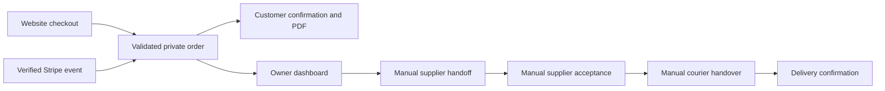

# How Asheerah Hair management connects to the business

Daily app: https://asheerahhair.com/gestao/

This is a working interface over the store's existing systems. The client can manage the normal order routine here; the technical owner maintains the payment, hosting, email and accounting services underneath it.

## What appears automatically

A website checkout request creates a private order record with products, selected options, quantities, customer/delivery details, discounts, shipping, total and checkout language. Merely adding an item to the browser cart does not create an order. Direct WhatsApp/offline sales and payments created outside this checkout do not appear automatically; they need an explicit manual-order/import feature.

For online payment, the order initially appears as an unfinished checkout. Stripe sends a signed callback; the backend checks its identity and amount and uses the existing accounting acknowledgement before recording paid status. The same confirmed order feeds the dashboard and the translated confirmation email/PDF. A cancelled, failed or unpaid checkout is not permission to ship.

For an eligible Orange Money request, the backend saves awaiting-payment status and sends the existing request confirmation/PDF. The owner checks the actual receipt outside the app, then records the reference and confirms the full amount here.

The normal dashboard refreshes about once a minute while visible, with no order dialog open and no extra data pages pending. **Atualizar** fetches current records immediately. It is polling, not a live courier feed. If an online callback/accounting acknowledgement fails, paid status may be delayed until retries succeed; the technical owner checks that integration rather than manually overriding an online payment.

## Which systems are connected

| System | Role in this workflow |
|---|---|
| asheerahhair.com storefront | Customer chooses products/options, destination, coupon and language and starts checkout |
| Cloudflare Worker | Validates requests and server-calculated money, stores orders, verifies payment events and serves private dashboard/sign-in endpoints |
| Stripe | Processes the online payment and sends its payment event |
| Existing Apps Script accounting | Records pending/paid online events and the initial manual request; not every dashboard action writes back to it |
| Private R2 storage | Durable order snapshots, operational stages, notes/history and short-lived sign-in/session records |
| Resend | Sends noreply confirmation emails/PDFs at the configured order triggers and private email sign-in codes |
| Management dashboard | Reads these private records and saves staff confirmations; it is not a separate payment processor |
| Supplier / courier | Work through the owner's existing external arrangements; their communications are not automated by the app |

The pending Orange Money notification is sent when that request is recorded. A later manual receipt confirmation is currently an operations update only, as explained below.

## The client's normal day

1. Open the app and sign in with an authorized email and its one-time inbox code. Start on **O meu dia** for orders needing action.
2. Check pending manual receipts and newly paid orders. Search/filter by customer, product, payment or fulfillment state when needed.
3. Open an order and check variants, quantities, customer notes and destination. An imported older order first needs its existing shipping state confirmed against the owner's records; the app does not assume every old paid order still needs sending.
4. Copy/download **Resumo para fornecedor**, send it manually through the usual channel, then select **Já enviei ao fornecedor**. The summary includes fulfillment details and omits retail prices and unnecessary customer email. Downloading alone does not mark it sent.
5. When the supplier accepts, select **Fornecedor confirmou**. Later, when parcel handover is confirmed, select **Transportadora confirmou** and optionally enter the tracking reference. These are two different facts.
6. Record delivery when confirmed. For pickup, record ready-for-collection and collected instead. Customer/courier communication stays independent through the normal channels.
7. Use internal notes and the attributed history for follow-ups. Simultaneous edits require refresh rather than silently overwriting another operator.

The phone interface provides bottom navigation, quick filters, readable cards, full-screen order detail, larger form controls and a persistent next-action footer. Desktop keeps the existing layout. A CSV export is available for the current filtered list.

## Important boundaries in this first version

- **Orange Money:** manual receipt confirmation is saved in the private operations record. It does not yet update the Apps Script accounting row or send a second paid-confirmation email. Those integrations need to be added if the owner wants them automated.
- **Financial totals:** gross order totals in EUR, including shipping and discounts, grouped by order creation date. They are not bank balances, Stripe payouts, cash flow by receipt date, tax statements or net profit. Refunds, fees, payouts, supplier costs and profit are not reconciled here yet.
- **Shipping:** the app records confirmations; it does not book shipments, generate courier labels, contact a supplier or message a customer when fulfillment changes.
- **History:** the initial import copied recent order snapshots still available at setup. It did not import the business's lifetime accounting history. Older records need a separate import. Durable business history is now independent of the temporary email spool's 30-day cleanup.
- **Pagination:** lists load 100 records at a time. A visible warning remains while more pages exist; totals and search cover loaded records until the remaining pages are loaded.
- **Corrections and other channels:** there is no refund/delete/fulfillment rollback or manual offline-order creation workflow in v1. Add a note and ask the technical owner if a correction is needed.

## What was actually verified

The owner confirmed live email-code sign-in. Unauthorized/forged-session/unlisted-account/cross-origin checks were rejected. The normal background job completed the recent-order import, verified from its timestamp marker without exporting customer data.

Automated tests exercise checkout -> private archive -> authenticated management API for Stripe and Orange Money. The online path includes a signed paid callback, duplicate suppression and confirmation email/PDF; the manual path remains awaiting payment. Provider calls were simulated: no new real charged purchase or customer order was created for testing, and no actual parcel handover is claimed.

Phone checks cover narrow-screen overflow, navigation, quick/advanced filters, full-screen details and confirmation with a shortened keyboard-sized viewport. Preview screenshots use fictional data.
